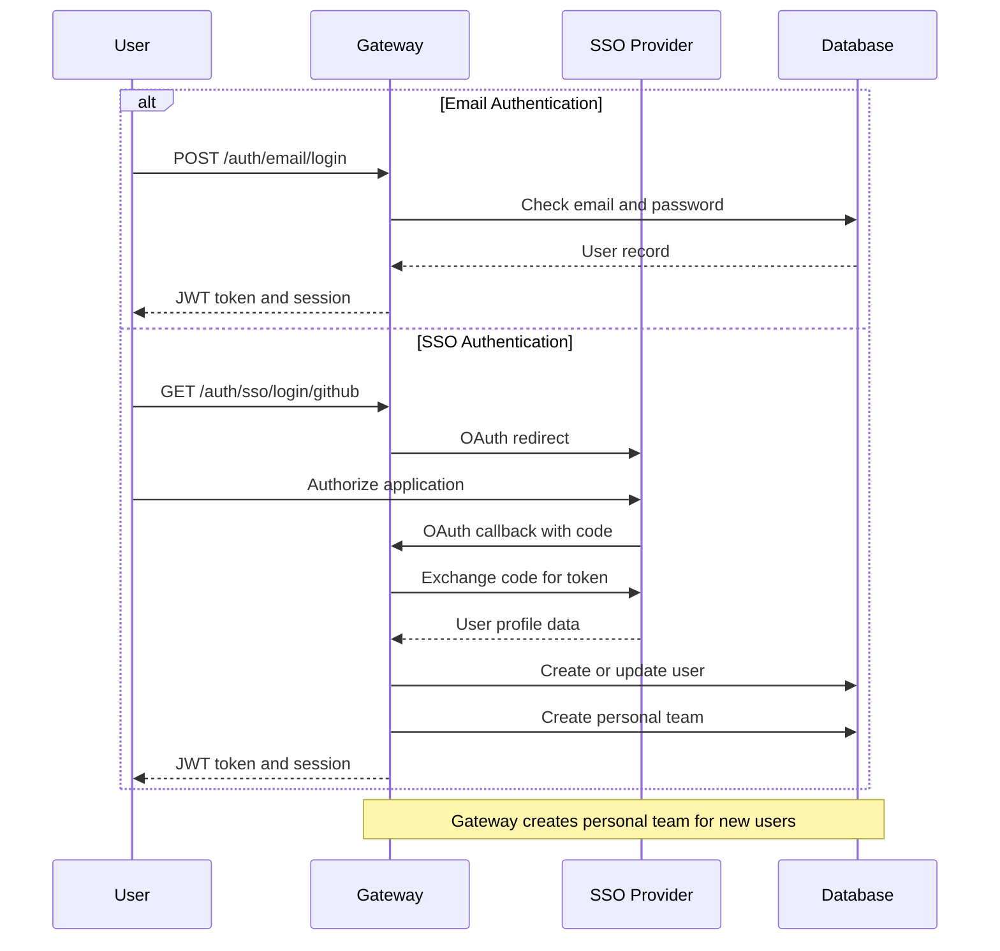
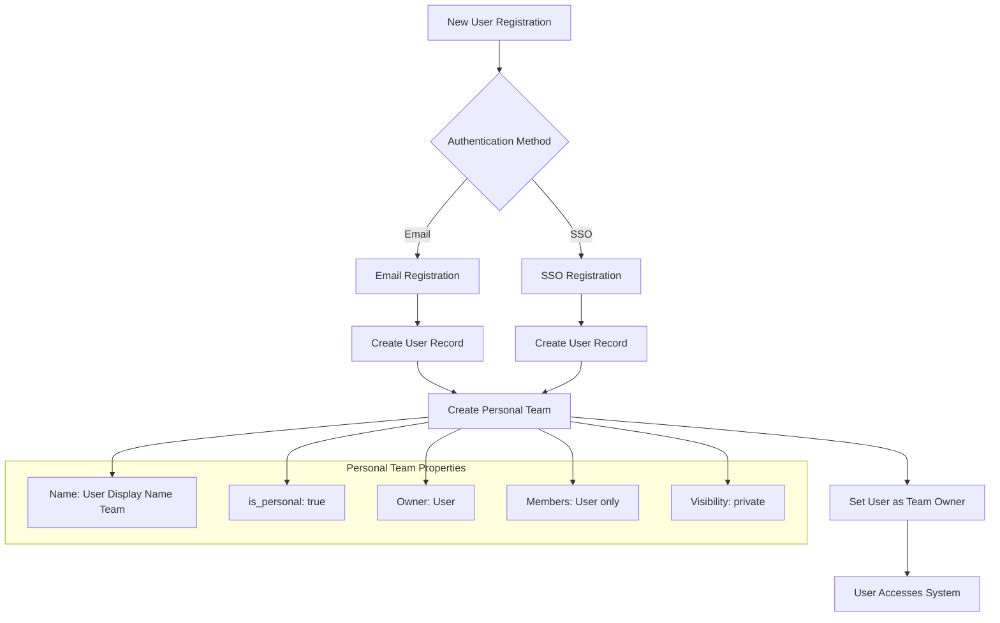
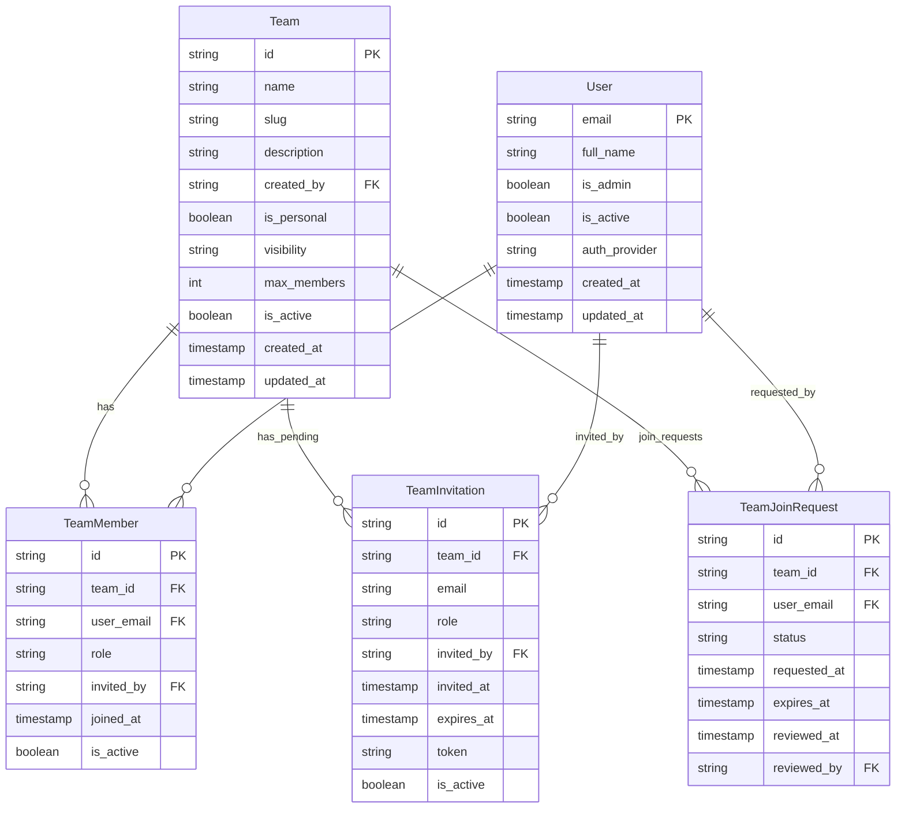
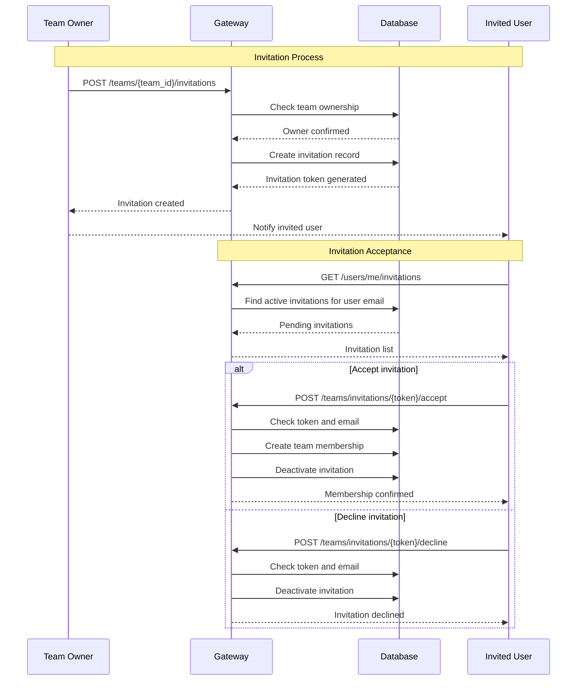
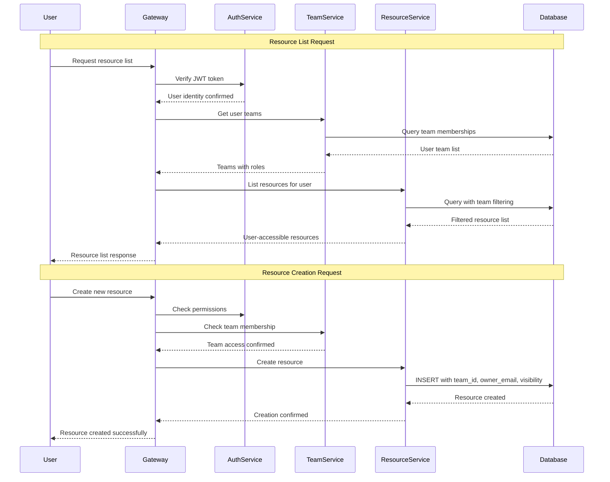

# Multi-Tenancy Architecture

ContextForge implements a multi-tenant architecture that provides data isolation, resource sharing, and access control. This document describes the multi-tenancy design, user lifecycle, team management, and resource scoping mechanisms.

## Overview

The multi-tenancy system uses **teams as the primary organizational unit**. Users belong to one or more teams. All resources belong to teams with configurable visibility levels.

### Core Principles

1. **Team-Centric**: Teams serve as the fundamental unit for resource ownership and access control.
2. **User Flexibility**: Users can belong to multiple teams with different roles in each team.
3. **Resource Isolation**: Resources belong to teams with explicit sharing controls.
4. **Invitation-Based**: Team owners control team membership through invitation workflows.
5. **Role-Based Access**: Users have roles within teams that determine their permissions.
6. **Platform Administration**: Platform administrators manage global system settings.

### Global Root Configuration

MCP roots are global, process-local platform configuration. Roots are not team-owned resources. Team-scoped identities cannot read or modify roots, even when a role grants `admin.system_config`.

Root registration is disabled by default because `ROOT_ALLOWED_SCHEMES` defaults to an empty list. Operators must explicitly configure supported schemes. File roots (`file://`) also require `ROOT_ALLOW_FILE_SCHEME=true` and configured file path prefixes. Invalid `DEFAULT_ROOTS` cause startup to fail. Deployments that use defaults must configure matching root policy before upgrade or restart.

---

## User Lifecycle and Authentication

### User Authentication Flow



### User Creation and Personal Teams

When personal teams are enabled (`AUTO_CREATE_PERSONAL_TEAMS=true`), the system creates a **Personal Team** for each new user:



---

## Team Architecture and Management

### Team Structure and Roles



### Team Membership Levels

Team membership levels operate independently from RBAC roles. A user holds a team membership level and can also hold RBAC role assignments within that team.

- **Owner**:
  - Manages team settings (name, description, visibility) and lifecycle. Users cannot delete personal teams.
  - Manages membership (invites, accepts, updates roles, deletes members).
  - Controls team resources subject to platform policies.

- **Member**:
  - Accesses and uses team resources.
  - Creates team resources by default unless restricted by policy.
  - Cannot manage team membership or team settings.

**Platform Admin** is a global RBAC role with system-wide access, not a team membership level.

### Team Invitation Workflow



---

## Visibility Semantics

### Team Visibility

- **Private**:
  - Discoverability: Visible only to team members and owners. Non-members cannot list private teams.
  - Membership: Requires an invitation from a team owner. Non-members cannot submit join requests.
  - API and UI: The team appears only in member team lists. Direct links require active membership.

- **Public**:
  - Discoverability: Listed in team discovery views for all authenticated users.
  - Membership: Requires an invitation or approval of a join request.
  - API and UI: Non-members can view team metadata. Resource access and management operations require membership.

Platform administrators can view and manage all teams regardless of team visibility.

### Resource Visibility

Resource visibility applies to Tools, Virtual Servers, MCP Gateways, Resources, Prompts, and A2A Agents. Each resource belongs to a team (`team_id`) and has a creator (`owner_email`).

- **Private**:
  - Visibility: Visible only to the resource creator (`owner_email`). The user token must include active team scope (`token_teams` non-empty).
  - Team members cannot see or execute private resources owned by other users.
  - Public-only tokens (`token_teams=[]`) cannot access private resources even if owned by the caller.
  - Platform administrator bypass (`token_teams=null`, `is_admin=true`) does not grant access to private resources owned by other users. Direct reads return 404 under bypass.
  - Modifications: Only the resource owner can modify or delete private resources.

- **Team**:
  - Visibility: Visible to all members of the owning team.
  - Modifications: The resource owner and team owners can update or delete team resources. Platform administrators can override.

- **Public**:
  - Visibility: Visible to all authenticated platform users across teams.
  - Modifications: The resource owner, team owners, or platform administrators can modify or delete public resources.

Enforcement summary:

- Listing queries match resources where `visibility = 'public'`, or `team_id IN token_teams` with `visibility IN ('team', 'public')`, or `owner_email = user.email` with `visibility = 'private'`.
- Ownership grants access only to private resources. Ownership does not bypass team scoping for team resources outside the active token scope.
- Public-only tokens (`token_teams=[]`) access public resources only. The system suppresses owner and team access.
- Read operations follow listing rules. Write operations require ownership or administrative permissions.

### Resource URI Uniqueness

Per the MCP specification, `uri` identifies a resource, and `name` provides a display label. Resource names are not required to be unique.

Uniqueness enforcement operates at two levels:

**Database Constraints (`mcpgateway/db.py`)**:

| Constraint | Key | Condition |
|---|---|---|
| `uq_team_owner_gateway_uri_resource` | `(team_id, owner_email, gateway_id, uri)` | Always |
| `uq_team_owner_uri_resource_local` | `(team_id, owner_email, uri)` | `gateway_id IS NULL` |

**Application Pre-Check (`mcpgateway/services/resource_service.py`)**:

The application runs a pre-check before inserting resources to return a clear 409 error on collision:

| Visibility | Pre-Check Key on Create |
|---|---|
| `public` | `(uri, visibility, gateway_id)` |
| `team` | `(uri, visibility, team_id, gateway_id)` |
| `private` | `(uri, visibility, owner_email, team_id, gateway_id)` |

---

## Token Scoping Model

### How Token Scoping Works

Token scoping determines which resources a user can see based on the `teams` claim in their JWT token.

Key functions in `mcpgateway/auth.py`:

- `normalize_token_teams()`: Interprets JWT team claims into canonical form. API tokens and legacy tokens use this function.
- `resolve_session_teams()`: Resolves session token teams from the database first. If the JWT contains team claims, the function narrows the result to the intersection of database teams and JWT teams. When the intersection is empty, the function returns `[]` (public-only). An explicit empty list `teams: []` in a session token requests no restriction and returns all database teams.
- `_narrow_by_jwt_teams()`: Computes the intersection of database teams and JWT teams.

### Token Scoping Rules

#### API Tokens and Legacy Tokens

API and legacy tokens use `normalize_token_teams()`. The JWT `teams` claim is the sole authority:

| JWT `teams` State | `is_admin` | Result | Access Level |
|---|---|---|---|
| Key missing | any | `[]` | Public-only (secure default) |
| Key `null` | `true` | `None` | Admin bypass (unrestricted) |
| Key `null` | `false` | `[]` | Public-only (no bypass) |
| Key `[]` (empty) | any | `[]` | Public-only |
| Key `["t1", "t2"]` | any | `["t1", "t2"]` | Team-scoped |

#### Session Tokens

Session tokens use `resolve_session_teams()`. Database records serve as the authority:

| JWT `teams` State | DB Teams | Result | Access Level |
|---|---|---|---|
| Key missing | `["t1", "t2"]` | `["t1", "t2"]` | Full DB membership |
| Key `null` | `["t1", "t2"]` | `["t1", "t2"]` | Full DB membership |
| Key `[]` (empty) | `["t1", "t2"]` | `["t1", "t2"]` | Full DB membership |
| Key `["t1"]` | `["t1", "t2"]` | `["t1"]` | Narrowed to intersection |
| Key `["revoked"]` | `["t1", "t2"]` | `[]` | Public-only (fail-closed) |
| any | `None` (admin) | `None` | Admin bypass |

A missing `teams` claim on an API token always defaults to public-only access. Admin bypass requires explicit `teams: null` with `is_admin: true`.

External identity provider tokens provisioned through `SSO_API_TOKEN_AUTH_ENABLED` follow the session token resolution path.

### Multi-Team Token Behavior

When a token lists multiple teams (`teams: ["team-1", "team-2"]`):

- **Listing queries**: Return resources visible to any listed team.
- **`request.state.team_id`**: Defaults to the first team in the list.
- **Resource creation**: Assigns the resource to `request.state.team_id` when the request omits `team_id`.

---

## Two-Layer Security Model

ContextForge combines two security layers:

```
Request: POST /tools/{id}/execute
    │
    ▼
┌─────────────────────────────┐
│ Token Scoping (Layer 1)     │ ← Can user see this tool?
│ - Check resource visibility │   (public/team/private)
│ - Check team membership     │
└─────────────────────────────┘
    │ (allowed)
    ▼
┌─────────────────────────────┐
│ RBAC Permission (Layer 2)   │ ← Can user execute tools?
│ @require_permission(        │   (tools.execute permission)
│   "tools.execute")          │
└─────────────────────────────┘
    │ (allowed)
    ▼
┌─────────────────────────────┐
│ Execute Operation           │
└─────────────────────────────┘
```

### Layer 1: Token Scoping (Data Filtering)

Token scoping controls what resources a user can see. `TokenScopingMiddleware` and service-layer database queries enforce this layer before RBAC checks.

### Layer 2: RBAC (Action Authorization)

RBAC controls what actions a user can perform. `@require_permission` decorators check role assignments and permission sets after token scoping succeeds.

### Enforcement Points Matrix

| Location | Token Scoping | RBAC | Notes |
|---|---|---|---|
| Token Scoping Middleware | Yes | No | Request-level data filtering |
| REST API Endpoints | Yes | Yes | Checked by `@require_permission` |
| RPC Handler (`/rpc`) | Yes | Method-specific | Method-level authorization |
| Admin UI | Yes | Yes | Controls view rendering and actions |
| Service Layer | Yes | No | Database query filtering |
| WebSocket | Yes | Yes | Forwards authentication to `/rpc` |
| MCP Transport | Yes | No | Streamable HTTP filtering and OAuth checks |

---

## Role-Based Access Control (RBAC)

ContextForge creates four built-in roles during system bootstrap:

### Built-in Roles

#### 1. Platform Admin (Global Scope)
- **Permissions**: `*` (all permissions)
- **Scope**: Global
- **Use Case**: System administrators who manage the entire platform.

#### 2. Team Admin (Team Scope)
- **Permissions**: `teams.read`, `teams.update`, `teams.join`, `teams.manage_members`, `tools.read`, `tools.execute`, `resources.read`, `prompts.read`
- **Scope**: Team
- **Use Case**: Team leaders who manage team members and team settings.

#### 3. Developer (Team Scope)
- **Permissions**:
  - `admin.dashboard`, `admin.overview`
  - `gateways.read`, `gateways.create`, `gateways.update`, `gateways.delete`
  - `servers.read`, `servers.use`, `servers.create`, `servers.update`, `servers.delete`
  - `teams.read`, `teams.join`
  - `tools.read`, `tools.create`, `tools.update`, `tools.delete`, `tools.execute`, `tools.preview`
  - `plugins.read`
  - `resources.read`, `resources.create`, `resources.update`, `resources.delete`
  - `prompts.read`, `prompts.create`, `prompts.update`, `prompts.delete`
  - `a2a.read`, `a2a.create`, `a2a.update`, `a2a.delete`, `a2a.invoke`
  - `llm.read`, `llm.invoke`
  - `tokens.create`, `tokens.read`, `tokens.update`, `tokens.revoke`
- **Scope**: Team
- **Use Case**: Team members who create and manage tools, servers, prompts, and gateways.

#### 4. Viewer (Team Scope)
- **Permissions**: `teams.join`, `tools.read`, `resources.read`, `prompts.read`
- **Scope**: Team
- **Use Case**: Team members who require read-only access to team resources.

---

## End-to-End Resource Access



---

## Configuration and Environment

### Multi-Tenancy Environment Variables

```bash
# Team Settings
AUTO_CREATE_PERSONAL_TEAMS=true
PERSONAL_TEAM_PREFIX=personal
MAX_TEAMS_PER_USER=50
MAX_MEMBERS_PER_TEAM=100

# Team Invitation Settings
INVITATION_EXPIRY_DAYS=7
REQUIRE_EMAIL_VERIFICATION_FOR_INVITES=true

# Team Governance
ALLOW_TEAM_CREATION=true
ALLOW_TEAM_JOIN_REQUESTS=true
ALLOW_TEAM_INVITATIONS=true

# Platform Administration
PLATFORM_ADMIN_EMAIL=admin@company.com
PLATFORM_ADMIN_PASSWORD=your-admin-password <!-- pragma: allowlist secret -->
PLATFORM_ADMIN_FULL_NAME="Platform Administrator"

# SSO Configuration
SSO_ENABLED=true
SSO_TRUSTED_DOMAINS=["company.com","trusted-partner.com"]
SSO_AUTO_ADMIN_DOMAINS=["company.com"]
SSO_GITHUB_ADMIN_ORGS=["your-org"]
SSO_GOOGLE_ADMIN_DOMAINS=["your-google-workspace-domain.com"]
SSO_REQUIRE_ADMIN_APPROVAL=false
```

---

## Security Considerations and Invariants

The platform enforces these security invariants on all access paths:

1. `normalize_token_teams()` is the canonical interpreter of JWT team claims. `resolve_session_teams()` is the single policy point for session tokens.
2. For API and legacy tokens, a missing `teams` key returns `[]` (public-only). An empty `teams: []` list also returns `[]`.
3. For session tokens, missing, null, or empty `teams` returns full database team membership.
4. Admin bypass for API tokens requires both `teams: null` and `is_admin: true`. For session tokens, admin bypass comes from the database `is_admin` flag.
5. All list endpoints pass `token_teams` to the service layer.
6. The service layer filters visibility using `token_teams` in `BaseService._apply_access_control()`.
7. Public-only tokens access `visibility='public'` resources only. Owner and team access are suppressed.
8. Owner access (`owner_email`) grants visibility for `visibility='private'` resources only. It does not bypass team scoping for team resources.
