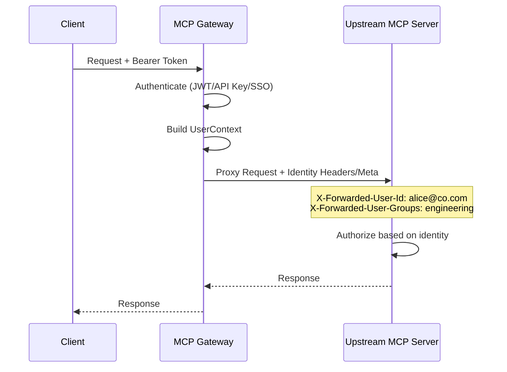

# Identity Propagation

Forward end-user identity from the gateway to upstream MCP servers.

## Overview

MCP Gateway authenticates inbound requests and extracts user identity (email, teams, roles, admin status). With identity propagation enabled, this identity is securely forwarded to upstream MCP servers when the gateway proxies tool calls, resource reads, and other MCP operations.

This enables upstream services to:

- Make **authorization decisions** based on the original caller's identity
- Produce **audit trails** that trace actions back to the real end user
- Implement **per-user rate limiting** or data filtering at the upstream level
- Support **on-behalf-of flows** (RFC 8693 token exchange)

## Architecture



## Configuration

### Global Settings

| Variable | Default | Description |
|----------|---------|-------------|
| `IDENTITY_PROPAGATION_ENABLED` | `false` | Master switch for identity propagation |
| `IDENTITY_PROPAGATION_MODE` | `both` | Propagation method: `headers`, `meta`, or `both` |
| `IDENTITY_PROPAGATION_HEADERS_PREFIX` | `X-Forwarded-User` | Prefix for HTTP identity headers |
| `IDENTITY_SENSITIVE_ATTRIBUTES` | `["password_hash","internal_id","ssn"]` | Attributes stripped before propagation |
| `IDENTITY_SIGN_CLAIMS` | `false` | HMAC-sign claims for upstream verification |
| `IDENTITY_CLAIMS_SECRET` | (none) | Signing secret (falls back to `JWT_SECRET_KEY`) |

### Enabling Identity Propagation

```bash
# .env
IDENTITY_PROPAGATION_ENABLED=true
IDENTITY_PROPAGATION_MODE=both
```

## Propagation Modes

### HTTP Headers (`headers`)

The gateway injects HTTP headers into upstream requests:

| Header | Example | Description |
|--------|---------|-------------|
| `X-Forwarded-User-Id` | `alice@company.com` | Authenticated user ID |
| `X-Forwarded-User-Email` | `alice@company.com` | User email |
| `X-Forwarded-User-Admin` | `true` | Whether user is admin |
| `X-Forwarded-User-Groups` | `engineering,platform` | Comma-separated groups |
| `X-Forwarded-User-Teams` | `team-alpha,team-beta` | Comma-separated teams |
| `X-Forwarded-User-Roles` | `developer` | Comma-separated roles |
| `X-Forwarded-User-Auth-Method` | `bearer` | Authentication method used |
| `X-Forwarded-User-Team-Id` | `team-alpha` | Active team context |
| `X-Forwarded-User-Service-Account` | `ci-bot` | Service account (if acting on behalf) |
| `X-Forwarded-User-Delegation-Chain` | `ci-bot>alice` | Delegation chain |
| `X-Forwarded-User-Claims-Signature` | `<hmac>` | HMAC signature (when signing enabled) |

The header prefix is configurable via `IDENTITY_PROPAGATION_HEADERS_PREFIX`.

### MCP Meta (`meta`)

The gateway injects user identity into the MCP `_meta` field:

```json
{
  "_meta": {
    "user": {
      "id": "alice@company.com",
      "email": "alice@company.com",
      "is_admin": false,
      "groups": ["engineering", "platform"],
      "teams": ["team-alpha"],
      "roles": ["developer"],
      "auth_method": "bearer"
    }
  }
}
```

### Both (`both`)

Default mode. Sends identity via both HTTP headers and MCP `_meta` for maximum compatibility.

## Per-Gateway Configuration

Each gateway registration can override the global identity propagation settings via the `identity_propagation` JSON field:

```json
{
  "name": "sensitive-upstream",
  "url": "https://internal-mcp.example.com",
  "identity_propagation": {
    "enabled": true,
    "mode": "headers",
    "headers_prefix": "X-Auth-User",
    "sign_claims": true,
    "allowed_attributes": ["email", "groups", "team_id"]
  }
}
```

Per-gateway settings take precedence over global defaults. If a gateway sets `"enabled": false`, identity will not be propagated to that upstream regardless of the global setting.

## Claim Signing

When `IDENTITY_SIGN_CLAIMS=true`, the gateway appends an HMAC-SHA256 signature to the propagated claims:

- **Headers mode**: Adds `X-Forwarded-User-Claims-Signature` header
- **Meta mode**: Adds `claims_signature` field to the `_meta.user` object

The signature covers the canonical JSON representation of the identity payload. Upstream servers can verify the signature using the shared secret to confirm the claims originated from the gateway.

```bash
# Enable claim signing
IDENTITY_SIGN_CLAIMS=true
IDENTITY_CLAIMS_SECRET=my-shared-secret  # or uses JWT_SECRET_KEY
```

## Sensitive Attribute Filtering

Before propagating identity, the gateway strips attributes listed in `IDENTITY_SENSITIVE_ATTRIBUTES`. This prevents internal-only fields (password hashes, internal IDs) from leaking to upstream services.

```bash
IDENTITY_SENSITIVE_ATTRIBUTES=["password_hash","internal_id","ssn","employee_number"]
```

## Session Identity Isolation

When identity propagation is enabled, identity headers (`x-forwarded-user-id`, `x-forwarded-user-email`) are included in upstream requests. The session affinity layer uses these headers to ensure different users get isolated upstream sessions even when connecting to the same gateway.

## Audit Trail Integration

When identity propagation is active, audit trail entries are enriched with:

- **`auth_method`**: The authentication method used (`bearer`, `api_key`, `basic`, `sso`, `proxy`)
- **`acting_as`**: The service account identity when acting on behalf of a user
- **`delegation_chain`**: The full chain of delegated identities

## Plugin Access

Plugins can access the authenticated user's identity through the `PluginContext`:

```python
class MyPlugin(PluginBase):
    async def process(self, context: PluginContext) -> PluginResult:
        user = context.user_context  # Full UserContext object
        email = context.user_email   # Shorthand for user email
        groups = context.user_groups # Shorthand for user groups

        if user and user.is_admin:
            # Admin-specific logic
            pass
```

## Migrating OAuth Gateways to Token Exchange

[RFC 8693 Token Exchange](../architecture/oauth-design.md#token-exchange-rfc-8693--on-behalf-of) (`grant_type: "token-exchange"`) is a strictly **opt-in** OAuth grant for gateways. It is a distinct configuration path from the OAuth flows described in [OAuth 2.0 Integration Design](../architecture/oauth-design.md).

### Impact on Existing Gateways

Existing gateways configured with `grant_type: "client_credentials"`, `"authorization_code"`, or `"password"` are **unaffected**. Token exchange is only activated when a gateway's `oauth_config.grant_type` is explicitly set to `"token-exchange"`.

### Converting a Gateway to On-Behalf-Of

1. Update the gateway's `oauth_config` to set `"grant_type": "token-exchange"`.
2. Add the required `"target_audience"` field, identifying the downstream resource.
3. Confirm the Authorization Server at `token_url` has RFC 8693 token exchange enabled and **trusts the ContextForge JWT issuer** — either via direct configuration of ContextForge as a trusted token issuer, or via federated SSO where both ContextForge and the downstream IdP share a common issuer.
4. Optionally set `"subject_token_source"` (defaults to `"inbound_user_jwt"`) and `"requested_token_type"` (defaults to `urn:ietf:params:oauth:token-type:access_token`).

See the [worked configuration example](../architecture/oauth-design.md#example-configuration) in the OAuth design doc.

#### Adding a discovery credential

Without a discovery credential, registration, health checks, and scheduled auto-refresh skip a token-exchange gateway, and every tool refresh needs a user token that the Authorization Server accepts. Add a `discovery` object to let ContextForge discover tools with a service token:

```json
{
  "grant_type": "token-exchange",
  "token_url": "https://as.example.com/oauth2/token",
  "client_id": "contextforge",
  "client_secret": "...",
  "target_audience": "https://mcp.example.com",
  "scopes": ["mcp.call"],
  "discovery": {
    "grant_type": "client_credentials",
    "scopes": ["mcp.discover"],
    "client_id": "contextforge-discovery",
    "client_secret": "..."
  }
}
```

- `discovery.grant_type` must be `client_credentials`.
- `token_url`, `client_id`, `client_secret`, `token_endpoint_auth_method`, and `scopes` are optional overrides. Unset keys inherit from the parent `oauth_config`.
- `discovery.token_url` passes the same SSRF validation as `token_url`. `discovery.client_secret` is stored encrypted and masked on read.
- Only a platform admin can add, change, or remove `discovery`.

The discovery token is used only for `initialize`, `tools/list`, `resources/list`, `prompts/list`, and health probes. Tool calls, resource reads, and prompt gets always use the per-user exchange, and fail without a usable user JWT. See [Tool discovery for token-exchange gateways](../architecture/oauth-design.md#tool-discovery-for-token-exchange-gateways) for caching and audit details.

!!! warning "Upstream policy requirement"
    Configure the upstream MCP server to accept the discovery service token for `initialize` and the list methods only. It must reject that token for `tools/call`, `resources/read`, and `prompts/get`, and require a token exchanged for the calling user. ContextForge never sends the service token on an invocation, but the upstream policy is the second layer of that boundary.

The catalog shows every tool the discovery identity can list. A user who calls a tool that the upstream does not allow for them gets an upstream authorization error.

#### Requesting delegation tokens

By default, the exchanged token identifies only the user (impersonation). To let the upstream MCP server verify that ContextForge acted for the user, set `actor_token_source`. ContextForge then sends an RFC 8693 `actor_token` with every exchange, and an Authorization Server that supports delegation adds an `act` claim to the issued token.

Use the gateway's own client credentials as the actor:

```json
{
  "grant_type": "token-exchange",
  "token_url": "https://as.example.com/oauth2/token",
  "client_id": "contextforge",
  "client_secret": "...",
  "target_audience": "https://mcp.example.com",
  "actor_token_source": "client_credentials"
}
```

Or sign an actor JWT with the gateway's private key (configure the key through the REST API):

```json
{
  "grant_type": "token-exchange",
  "token_url": "https://as.example.com/oauth2/token",
  "client_id": "contextforge",
  "token_endpoint_auth_method": "private_key_jwt",
  "private_key": "<PEM-encoded RSA or EC private key>",
  "target_audience": "https://mcp.example.com",
  "actor_token_source": "client_assertion"
}
```

- `actor_token_source` accepts `none` (default), `client_credentials`, or `client_assertion`.
- `actor_token_type` is optional. It defaults to `urn:ietf:params:oauth:token-type:access_token` for `client_credentials` and `urn:ietf:params:oauth:token-type:jwt` for `client_assertion`.
- `client_assertion` needs a stored or submitted `private_key`.
- Only a platform admin can set, change, or remove these keys. Other grants reject them.
- Delegation fails closed. If ContextForge cannot get the actor token, the tool call fails and no impersonation request is sent.

Authorization server support varies:

| Authorization server | Delegation support |
|----------------------|--------------------|
| Keycloak 26.2 to 26.7 | Not supported. Standard token exchange supports impersonation only. |
| Keycloak with the `token-exchange-delegation` preview feature | Partial. Use `client_credentials`. Keycloak requires a `may_act` claim in the subject token, which ContextForge JWTs do not carry. |
| Other servers | Verify with the vendor before you turn on delegation. |

See [Delegation (actor token)](../architecture/oauth-design.md#delegation-actor-token) for the request sequence, caching, and audit details.

#### Using a separate actor client

Some authorization servers, such as IBM Security Verify, ignore the `audience` parameter. They issue the exchanged token to the client that authenticates the exchange. On such a server, create one gateway entry per upstream MCP server. Each entry authenticates as that server's client, and all entries share one ContextForge actor client:

```json
{
  "grant_type": "token-exchange",
  "token_url": "https://tenant.verify.ibm.com/oauth2/token",
  "client_id": "<mcp1 client ID>",
  "client_secret": "...",
  "target_audience": "<mcp1 client ID>",
  "actor_token_source": "client_credentials",
  "actor": {
    "client_id": "<contextforge client ID>",
    "client_secret": "..."
  }
}
```

- The exchange authenticates as `client_id`, so the issued token has `aud` set to that MCP server.
- The actor token comes from `actor`, so the issued token has `act` set to ContextForge.
- `actor` also accepts `token_url` and `token_endpoint_auth_method`. Omitted keys inherit the parent values.
- `actor` requires `actor_token_source` `client_credentials`.
- `actor.client_secret` is encrypted at rest and masked on read. Each gateway entry holds its own copy, so a secret rotation needs an update on every entry.
- On IBM Security Verify, the user token needs a `may_act` claim that names the ContextForge client.

See [Actor client override](../architecture/oauth-design.md#actor-client-override) for the full key list and the IBM Security Verify setup.

#### Configuring token exchange in the Admin UI

Platform admins can create and edit token-exchange gateways from the Admin UI. Select **OAuth 2.0** as the authentication type and **Token Exchange (RFC 8693 On-Behalf-Of)** as the grant type. The option is rendered only for platform admins; the server also rejects a token-exchange submission from any other user with `403`, including a `team_admin` of the gateway's own team.

| Field | Required | Default |
|-------|----------|---------|
| Token URL (`token_url`) | yes | — |
| Client ID (`client_id`) | yes | — |
| Client Secret (`client_secret`) | yes, unless the auth method is `private_key_jwt` or `none` | — |
| Token Endpoint Auth Method (`token_endpoint_auth_method`) | no | `client_secret_post` |
| Target Audience (`target_audience`) | yes | — |
| Subject Token Type (`subject_token_type`) | no | `urn:ietf:params:oauth:token-type:jwt` |
| Requested Token Type (`requested_token_type`) | no | `urn:ietf:params:oauth:token-type:access_token` |
| Subject Token Source (`subject_token_source`) | no | `inbound_user_jwt` |
| Scopes (`scopes`) | no | — |
| Actor Token Source (`actor_token_source`) | no | `none` |
| Actor Token Type (`actor_token_type`) | no | Default for the selected source |

The `client_assertion` actor source is selectable only on the edit form of a gateway that already has a stored `private_key`.

When the actor token source is `client_credentials`, an optional actor client group appears:

| Field | Required | Default |
|-------|----------|---------|
| Actor Client ID (`actor.client_id`) | no. A blank value stores no `actor`. | — |
| Actor Client Secret (`actor.client_secret`) | no | Parent `client_secret` |
| Actor Token URL (`actor.token_url`) | no | Parent `token_url` |
| Actor Client Authentication (`actor.token_endpoint_auth_method`) | no | Parent method |

Clear the actor client ID on the edit form to remove `actor`.

The token-exchange section also has a **Use a discovery credential (client credentials)** checkbox. When you select it, these fields appear:

| Field | Required | Default |
|-------|----------|---------|
| Discovery Scopes (`discovery.scopes`) | no | Parent `scopes` |
| Discovery Token URL (`discovery.token_url`) | no | Parent `token_url` |
| Discovery Client ID (`discovery.client_id`) | no | Parent `client_id` |
| Discovery Client Secret (`discovery.client_secret`) | no | Parent `client_secret` |

Selecting the checkbox with scopes `mcp.discover` stores `{"grant_type": "client_credentials", "scopes": ["mcp.discover"]}`. The UI does not expose `discovery.token_endpoint_auth_method`; set it through the REST API.

UI submissions pass through the same validation as `POST /gateways`, including the SSRF check on `token_url`, `discovery.token_url`, and `actor.token_url`.

The Admin UI does not upload `private_key_jwt` key material. Configure `private_key`, `private_key_jwt_kid`, and `token_endpoint_auth_signing_alg` through the REST API. The edit form then shows the stored `private_key_jwt` method and keeps the key.

When you edit a token-exchange gateway and keep the grant type:

- Settings the form does not show, such as `private_key`, keep their stored values.
- The client secret shows as `*****`. Leave it unchanged, or clear it, to keep the stored secret. Type a new value to replace it.
- Any other field you clear is removed from `oauth_config`.
- The stored actor token source and type fill the delegation fields. Saving an unrelated change keeps them.
- The stored discovery settings fill the discovery fields, and the discovery client secret shows as `*****`. Saving an unrelated change keeps the `discovery` object, its encrypted secret, and its API-only `token_endpoint_auth_method`. Clear the checkbox to remove the `discovery` object.
- Without a discovery credential, tools, resources, and prompts discovered earlier stay in the catalog, because a gateway update cannot run discovery without a user subject token. With a discovery credential, the update re-discovers and reconciles the catalog. A failed discovery token request leaves the catalog unchanged.

Changing the grant type away from `token-exchange` replaces `oauth_config` with the submitted fields only, so the token-exchange settings are removed.

A user who is not a platform admin sees the OAuth settings of a token-exchange gateway as read-only.

### Data and Audit Impact

No database migration is required for this MVP — token exchange is config-only. Audit events are recorded via the structured logging sink and persisted as `StructuredLogEntry` rows with `is_security_event=True`. Typed audit columns (dedicated token-exchange audit table/fields) are planned as a Phase 2 follow-up with its own Alembic migration.

### Rollback

To turn off delegation only, set `oauth_config.actor_token_source` to `none`. The next exchange for each user runs without an actor token.

To revert, set `oauth_config.grant_type` back to its previous value (e.g., `client_credentials`). No data cleanup is required — cached exchanged tokens expire according to their TTL (derived from the Authorization Server's `expires_in`) and are not reused once the grant type changes.

## Related

- [Configuration Reference](configuration.md#identity-propagation)
- [Proxy Authentication](proxy.md)
- [RBAC](rbac.md)
- [Teams](teams.md)
- [ADR-041: Identity Propagation](../architecture/adr/041-identity-propagation.md)
